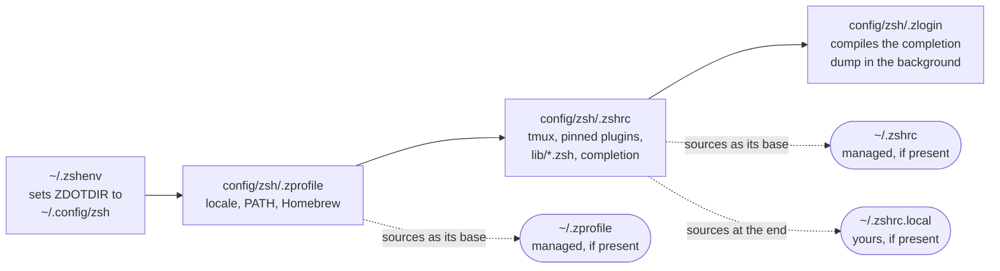

<div align="center">

# ShaneOG's Dotfiles

[](https://github.com/shaneog/dotfiles/actions/workflows/test.yml)
[](https://github.com/shaneog/dotfiles/actions/workflows/provision.yml)
[](https://github.com/shaneog/dotfiles/actions/workflows/audit.yml)
[](#install)
[](LICENSE.md)

**[Illustrated guides](https://ogrady.ie/dotfiles/)** ·
[Install](#install) ·
[Layout](#layout) ·
[What's inside](#whats-inside) ·
[Per-machine setup](#per-machine-setup) ·
[Scripts](#scripts) ·
[Tests](#tests) ·
[Performance](#zsh-performance)

</div>

> These are my dotfiles. There are many others like them, but these ones are
> mine. My dotfiles are my best friends. They are my life. I must master them as
> I must master my life. Without me, my dotfiles are useless. Without my
> dotfiles, I am useless.

zsh, tmux, Neovim, git and Ghostty for macOS on Apple Silicon, with the Homebrew
packages around them. One command installs everything on a new Mac, and one
script takes it out again.

- **Layers over a managed shell.** On a machine where another tool owns
  `~/.zprofile` and `~/.zshrc`, those files are sourced as a base layer instead
  of being replaced, and this config loads on top.
- **No private keys on disk.** SSH authentication and commit signing both go
  through 1Password's agent.
- **Links entries, not directories.** `~/.config` and `~/.ssh` stay real
  directories. Only what git tracks is linked into them, so other tools' files
  never end up in the clone.
- **Third-party shell code is pinned.** zinit, Prezto and the zsh plugins run at
  the commits in [`config/zsh/pins.zsh`](config/zsh/pins.zsh), and Renovate
  proposes the bumps.
- **Startup time is tested.** An interactive login shell starts in 70 to 145ms,
  depending on the Mac, and a test fails when it goes over budget.

## Guides

Illustrated, plain-language explanations of what all of this does and how it
works are published at <https://ogrady.ie/dotfiles/>. The source is in
[`guides/`](guides/): plain HTML with no build step, so the same pages open
from a clone:

```sh
open guides/index.html
```

## Install

On a new Mac, as your own user (an admin, not root):

```sh
/bin/bash -c "$(curl -fsSL https://raw.githubusercontent.com/shaneog/dotfiles/HEAD/script/bootstrap)"
```

It asks for your password once, for `sudo`, and then runs these steps in order:

| | Step | What it does |
| :-: | --- | --- |
| 1 | Homebrew | Installed, unless `brew` is already on the machine. |
| 2 | Clone | The repo goes to `~/.dotfiles`. If it is already there, it is updated with `git pull --rebase --autostash`. |
| 3 | [`script/setup`](script/setup) | Links the dotfiles into your home directory. See [what gets linked](#what-gets-linked). |
| 4 | [`script/macos`](script/macos) | Applies the macOS settings, Touch ID for `sudo`, and the Gotham profile for Terminal.app. |
| 5 | [`Brewfile`](Brewfile) | `brew bundle --global` installs the formulae, casks and fonts. |
| 6 | Login shell | Homebrew's zsh is added to `/etc/shells` and set with `chsh`. |
| 7 | [`script/macos`](script/macos) again | Only if its own check finds something left. On a new Mac that is Touch ID inside tmux, which needs `pam-reattach` from step 5. |
| 8 | [`script/after-setup`](script/after-setup) | Installs Neovim's plugins at the versions in the lockfile, and its treesitter parsers. |

The first shell you open afterwards installs zinit and the zsh plugins, and
tmux installs its own plugins the first time it starts.

> [!IMPORTANT]
> Two things are left to do by hand on a new machine. Create
> `~/.gitconfig-user`, because git cannot commit without it, and switch on
> 1Password's SSH agent. Both are covered under
> [commit signing](#commit-signing-required), and bootstrap ends by naming
> whichever of the two is still missing.

Running the same command again later is safe. So is `~/.dotfiles/script/bootstrap`.

### Installing from somewhere else

To install from somewhere other than the default branch (a branch you are still
working on, a fork, a mirror, or a copy on a drive, which is handy on a machine
that has no GitHub credentials yet):

```sh
DOTFILES_URL=/Volumes/stick/dotfiles ./script/bootstrap
DOTFILES_REF=some-branch ./script/bootstrap
GITHUB_USER=someone ./script/bootstrap    # github.com/someone/dotfiles
```

`DOTFILES_REF` only applies to a fresh clone. When `~/.dotfiles` already exists
it is pulled on whatever branch it has checked out.

## Layout

```text
.
├── Brewfile        formulae, casks and fonts, linked as ~/.Brewfile
├── config/         one entry per tool, each linked as ~/.config/<name>
│   ├── gh/  ghostty/  git/  homebrew/  karabiner/  mise/  nvim/  tmux/
│   ├── starship.toml
│   └── zsh/        .zshenv, .zprofile, .zshrc, .zlogin and pins.zsh
│       ├── autoload/   functions, loaded the first time each is called
│       └── lib/        one file per concern, sourced by .zshrc
├── ssh/config      linked as ~/.ssh/config
├── script/         bootstrap, setup, macos, after-setup, remove, and the test tooling
├── test/           static, unit, integration and vm tiers
├── guides/         the pages published at ogrady.ie/dotfiles
└── .github/        workflows, Dependabot and Renovate
```

### What gets linked

`script/setup` links `~/.Brewfile` and `~/.zshenv` into the clone, and then one
entry at a time inside two directories that stay real: `~/.config/<name>` for
each entry git tracks under `config/`, and `~/.ssh/config`.

```text
~/.zshenv              ->  ~/.dotfiles/config/zsh/.zshenv
~/.Brewfile            ->  ~/.dotfiles/Brewfile
~/.config/                 a real directory
    git                ->  ~/.dotfiles/config/git
    nvim               ->  ~/.dotfiles/config/nvim
    zsh                ->  ~/.dotfiles/config/zsh
    ...                    and the other entries git tracks under config/
    anything else          not ours, never touched
~/.ssh/                    a real directory
    config             ->  ~/.dotfiles/ssh/config
    config-local           a real file, written once if it is missing
    known_hosts            not ours, never touched
```

Everything else under `~/.config` and `~/.ssh` (other tools' settings,
`known_hosts`) is outside the clone, so it is never published and
`script/remove` leaves it alone. The one exception is a tool that writes inside
a directory that is itself linked: gh's `hosts.yml`, Homebrew's `trust.json` and
tmux's plugins land in the clone. They are git-ignored, and they go when the
clone does.

To add a tool's config: put it under `config/`, `git add` it, and run
`script/setup` again. Running it again is always safe: a correct link is left
alone, and anything else found at a target path is renamed to `<name>.bak.<time>`
rather than deleted.

An `~/.ssh` that already holds a private key (`id_*`) is taken to be managed by
something else, and `script/setup` links nothing into it.

A machine set up before this layout has `~/.config` and `~/.ssh` as links to the
clone's whole directories. Pull and run `script/setup` once: it moves everything
git does not track out of the clone into real directories, at the same paths
under `~`, and then links as above.

### How a shell starts

`~/.zshenv` is the only shell file this repo owns in your home directory. It
points `ZDOTDIR` at `~/.config/zsh`, so zsh reads the rest from there. A managed
`~/.zprofile` and `~/.zshrc` are left exactly as they are and sourced as a base
layer, and everything here loads after them. Rounded boxes are files this repo
does not own.



## What's inside

| Area | What you get |
| --- | --- |
| **Shell** | zsh with [zinit](https://github.com/zdharma-continuum/zinit), a handful of [Prezto](https://github.com/sorin-ionescu/prezto) modules, autosuggestions, extra completions, history substring search and `you-should-use`. Syntax highlighting is [zsh-patina](https://github.com/michel-kraemer/zsh-patina). |
| **Prompt** | [Starship](https://starship.rs/), configured in [`config/starship.toml`](config/starship.toml). |
| **Terminal** | [Ghostty](https://ghostty.org) and Terminal.app, both in the Gotham palette with FiraMono Nerd Font. |
| **tmux** | Starts by itself in a Ghostty or Terminal.app window and nowhere else. Prefix is `C-a`. Sessions are saved and restored by tmux-resurrect and tmux-continuum. |
| **Neovim** | A deliberately small `$EDITOR`: lazy.nvim with a committed lockfile, treesitter, gitsigns, fzf-lua and mini.nvim. |
| **git** | SSH commit and tag signing through 1Password, `diff-so-fancy` as the pager, fast-forward-only merges and pulls, and nine short aliases in [`lib/git.zsh`](config/zsh/lib/git.zsh). |
| **SSH** | Every host authenticates through 1Password's agent. Inside an inbound ssh session it defers to that session's own agent, normally a forwarded one. |
| **Runtimes** | [mise](https://mise.jdx.dev), with no tools declared globally. It replaced nodenv, pyenv, pyenv-virtualenv and sdkman. Declare them per project in a `mise.toml`, or with `mise use -g` on a machine where nothing else claims them. |
| **Search** | fzf, backed by ripgrep for files and fd for directories. |
| **Environment** | direnv, with its hook cached so startup does not pay for it. |
| **Keyboard** | Karabiner-Elements: Caps Lock is Control when held with another key, and Escape when tapped. |
| **macOS** | A table of `defaults` in [`script/macos`](script/macos). `script/macos --check` reports the ones that are not applied, and changes nothing. |
| **Packages** | The [`Brewfile`](Brewfile): command line tools, apps and Nerd Fonts. |

The cheat sheet in the guides lists the
[aliases and key bindings](https://ogrady.ie/dotfiles/tools.html).

## Per-machine setup

### Commit signing (required)

`config/git/config` turns on SSH signing for every commit and tag, but the key
itself is machine-specific, so **`~/.gitconfig-user` has to exist before the
first commit on a new machine**. Without it git fails with *either
user.signingkey or gpg.ssh.defaultKeyCommand needs to be configured*.

```
[user]
	name = Your Name
	email = you@example.com
	signingkey = ssh-ed25519 AAAA...        # the public key, not a path
```

Signing goes through 1Password's `op-ssh-sign`, so 1Password needs to be
installed and its SSH agent enabled (Settings, Developer, Use the SSH agent).
`git log --show-signature` verifies against
[`config/git/allowed_signers`](config/git/allowed_signers).

As an alternative to naming a key, `gpg.ssh.defaultKeyCommand = ssh-add -L`
signs with whatever the agent lists first. That is convenient, but it silently
follows the agent's ordering.

### Local overrides

These files are not tracked, and each one is read by the config beside it:

| Tracked file | Machine-specific file | Notes |
| --- | --- | --- |
| `config/git/config` | `~/.gitconfig-user` | Required. See above. |
| `ssh/config` | `~/.ssh/config-local` | Created by `script/setup` if it is missing. Read first, so it can override anything. |
| `config/zsh/.zshrc` | `~/.zshrc.local` | Optional. Sourced at the end of `.zshrc`. |

### Environment knobs

| Variable | Effect |
| --- | --- |
| `ZSH_NO_TMUX_AUTOSTART` | Don't attach a tmux session for this shell. Autostart only ever fires from Terminal.app or Ghostty, so editors, IDE terminals, ssh sessions and scripts are already left alone. |
| `ZSH_NO_ZCOMPILE` | Skip the background compile of the completion dump. |
| `DOTFILES_URL`, `DOTFILES_REF`, `GITHUB_USER` | Where `script/bootstrap` installs from. |
| `DOTFILES_COLD_CACHE`, `SKIP_PERF` | Turn the cold-cache tests on and the startup timing off. See [Tests](#tests). |
| `DOTFILES_STARTUP_BUDGET_MS` | The startup ceiling the timing test enforces. 200 by default. |

## Plugin versions

zinit, Prezto and the zsh plugins run at the commits listed in
[`config/zsh/pins.zsh`](config/zsh/pins.zsh), one line each. Renovate opens one
pull request, at most weekly, when any of their branches has moved
([`.github/renovate.json`](.github/renovate.json)), and CI installs them from
nothing at the proposed commits on that pull request.

Nothing needs running after a pin changes. The next shell on each machine moves
what it has installed to the new commits and says so once. `zinit update` does
not move a pinned plugin. To try a newer commit, change its line.

tmux's plugins are not pinned: tpm installs a branch, never a commit. The
weekly audit does check that none of their repositories has been archived.
Dependabot looks after one other thing, the action versions in the workflows.

## Scripts

| Script | What it is for |
| --- | --- |
| [`script/bootstrap`](script/bootstrap) | Sets up a machine from nothing. Runs the steps under [Install](#install). |
| [`script/setup`](script/setup) | Creates the links. Run it again after adding a config. |
| [`script/macos`](script/macos) | Applies the macOS settings. `--check` only reports, and `--reset-dock` also clears the Dock's pinned icons. The first run records the previous values under `~/.local/share/dotfiles/macos-defaults`. |
| [`script/after-setup`](script/after-setup) | Installs Neovim's plugins and treesitter parsers, headless. |
| [`script/remove`](script/remove) | Takes the dotfiles out again. See [Uninstall](#uninstall). |
| [`script/audit`](script/audit) | Finds upstream rot: renamed, deprecated or archived packages and plugins, and tools the config calls that no Brewfile installs. `make audit`. |
| [`script/brew-drift`](script/brew-drift) | Compares what this machine has installed with the Brewfile, in both directions. Advisory. `make brew-drift`. |
| [`script/mutate`](script/mutate), [`script/sweep`](script/sweep) | Test the tests. See [Tests](#tests). |

## Uninstall

```sh
~/.dotfiles/script/remove                # the dotfiles
~/.dotfiles/script/remove --everything   # and Homebrew, its packages and the Command Line Tools
```

It asks before doing anything. Then it removes the links in `~`, `~/.config`
and `~/.ssh`, the clone at `~/.dotfiles`, and the caches the shell config
generates, and sets the login shell back to `/bin/zsh`.

It leaves alone your shell history, everything under `~/.config` and `~/.ssh`
that is not a link into the clone, and the macOS settings `script/macos` wrote.
The Gotham profile has to be removed from Terminal.app by hand.

On a machine that still has the old whole-directory links it stops and asks for
`script/setup` to be run first, because removing the clone would take every
other tool's files with it.

## Tests

```sh
make test              # the three tiers below, about two minutes on a CI runner
make test-static       # parsing, linting and a secret scan
make test-unit         # capability guards and autoloaded functions
make test-integration  # the real startup chain in a disposable $HOME
```

Layering is covered by a fixture that impersonates a managed shell setup owning
`~/.zprofile` and `~/.zshrc`, so the tests behave the same on a machine that has
no such setup, and both configurations are asserted.

One suite is opt-in, being slow and network bound, and one can be skipped:

```sh
make test-cold                       # install every plugin from an empty cache
SKIP_PERF=1 make test-integration    # skip startup timing (CI skips it on push)
```

The suite has to pass under **bash 3.2**, which is what a stock Mac and the CI
runners provide, and which parses some things differently to a modern bash:

```sh
/bin/bash "$(command -v bats)" test/static test/unit test/integration
```

### Testing the tests

`make mutate` breaks each thing listed in
[`test/mutations.tsv`](test/mutations.tsv) on purpose and checks that the
assertion named beside it notices. A row that stops failing means an assertion
has gone blind.

`script/sweep` asks the opposite question. Instead of "does this assertion still
work", it comments out each line of config in turn and reports the ones no test
notices: a setting that could be deleted tomorrow without a single test
complaining. It is local only and slow (roughly 12s a line), so it takes
`--budget SECONDS` and resumes where the last run stopped:

```sh
make sweep                              # everything, 15 minutes' worth
script/sweep config/tmux/tmux.conf      # one file
```

Both need a clean working tree, because they edit tracked files in place.

Results accumulate in `$XDG_STATE_HOME/dotfiles/sweep.tsv` so successive runs
build on each other, and a result is dropped once its line is edited or moves.
`--out` points it elsewhere.

The tests it runs per file are declared in the script rather than derived from
the filename: a `grep` for `plugins.lua` finds nothing, while `nvim.bats` clearly
exercises it, and a `grep` for `fzf.zsh` finds only a fixture that names it.

### A fresh Mac in a VM

A fresh-machine test runs locally only, since CI runners are not fresh Macs:
Homebrew, the command line tools, pyenv and nvm are all preinstalled there.

```sh
make test-vm            # boot macOS 27 in Tart, install end to end, destroy
test/vm/run --keep      # leave the VM up to poke at
```

It boots the `-vanilla` image, which is macOS and nothing else. The `-base`
images already have Homebrew and the command line tools, and the run refuses
them. `VM_IMAGE` picks another release, such as the one before:

```sh
VM_IMAGE=ghcr.io/cirruslabs/macos-tahoe-vanilla:latest make test-vm   # macOS 26
```

It needs Apple Silicon, about 60GB of free disk, and [Tart](https://tart.run),
which Homebrew now gates behind tap trust:

```sh
brew trust --formula openai/tools/softnet
brew install openai/tools/tart
```

`script/bootstrap` is pointed at a copy of the working tree via `DOTFILES_URL`,
so it installs the current branch rather than whatever is on the default one.

<details>
<summary>How long a run takes, measured on macOS 27 in November 2026</summary>

<br>

The image is tens of gigabytes on first use, but it is cached after that.

| | |
| --- | --: |
| Pulling the image (once) | 394s |
| Boot, ssh, copy the tree in | 20s |
| `script/bootstrap`, of which | 159s |
| &nbsp;&nbsp;Homebrew from scratch, command line tools included | 96s |
| &nbsp;&nbsp;`script/setup` and `script/macos` | 1s |
| &nbsp;&nbsp;Brewfile, formulae only | 55s |
| &nbsp;&nbsp;`after-setup` | 7s |
| First login shell, installing every plugin | 12s |
| **Whole run, image cached** | **195s** |

So a bare machine reaches a working shell inside three minutes, plus whatever
the casks cost. Over half of that is Homebrew, which installs the command line
tools first on a machine that has never had them.

This test has earned its keep twice. `script/macos` used to take 121s of a run,
all of it an AppleScript waiting on an AppleEvent that a headless machine can
never deliver. And `after-setup` could hang indefinitely on a "Press ENTER"
prompt. It did so intermittently, which is why it needed a real machine to
catch: CI passed it every time, because a runner hands every step `/dev/null` on
stdin.

</details>

### Continuous integration

| Workflow | Runs | What it does |
| --- | --- | --- |
| [`test`](.github/workflows/test.yml) | Pull requests, pushes to `main`, weekly | The three tiers, with unit and integration against both the system and Homebrew zsh, and the mutation manifest. |
| [`cold`](.github/workflows/cold.yml) | Pull requests that change `pins.zsh`, weekly | Installs every plugin from an empty cache. |
| [`provision`](.github/workflows/provision.yml) | Weekly, on demand | Runs `bootstrap`, `setup`, `macos` and `remove` for real on disposable runners, since they otherwise only ever run on a new machine. |
| [`audit`](.github/workflows/audit.yml) | Weekly, on demand | `script/audit`. |
| [`pages`](.github/workflows/pages.yml) | Pushes to `main` that touch `guides/` | Publishes the guides. |

## ZSH performance

Currently **~72ms** for an interactive login shell in isolation on the fastest
Mac this repo is used on, ~143ms on the slowest, and between 130 and 185ms on a
shared CI runner. A machine that also has a managed shell setup layered
underneath came to ~330ms when last measured, against ~146ms there for this
repo alone. That setup costs more than this repo does, and none of it is this
repo's to reclaim.

Measured with `hyperfine` and guarded by a budget in
[`test/integration/perf.bats`](test/integration/perf.bats), which prints what it
measured on every run:

```sh
hyperfine --warmup 3 'zsh -lic exit'
```

Most of what remains is plugin loading. Two things dominated it historically and
are worth remembering: a completion dump that was never cached cost ~340ms per
shell, and compiling the zsh sources to `.zwc` saved nothing measurable.

<details>
<summary>Historical log from 2022, kept for the shape of the curve and not as current figures</summary>

<br>

Benchmark details:

- macOS Monterey 12.2.1
- Terminal.app
- command: `for i in $(seq 1 10); do /usr/bin/time zsh -i -c exit; done`

References:

- https://htr3n.github.io/2018/07/faster-zsh/
- https://carlosbecker.com/posts/speeding-up-zsh/

| Setup | Real time per shell |
| --- | --: |
| Factory fresh, no dotfiles | 0.00 to 0.02s |
| These dotfiles before 2022-03-06, on zplug | 2.15 to 2.29s |
| 1:1 copy on zinit | 0.22 to 0.25s |
| Refactored, with Starship as the prompt | 0.64 to 0.70s |
| The same with `zinit light`, no turbo mode | 0.70 to 0.76s |

**Factory fresh install.** No dotfiles.

```
        0.02 real         0.00 user         0.00 sys
        0.01 real         0.00 user         0.00 sys
        0.01 real         0.00 user         0.00 sys
        0.01 real         0.00 user         0.00 sys
        0.00 real         0.00 user         0.00 sys
        0.00 real         0.00 user         0.00 sys
        0.00 real         0.00 user         0.00 sys
        0.00 real         0.00 user         0.00 sys
        0.00 real         0.00 user         0.00 sys
        0.00 real         0.00 user         0.00 sys
```

**These dotfiles, before 2022-03-06.**

```
        2.29 real         0.68 user         0.76 sys
        2.29 real         0.66 user         0.78 sys
        2.24 real         0.65 user         0.75 sys
        2.23 real         0.65 user         0.77 sys
        2.18 real         0.66 user         0.74 sys
        2.23 real         0.66 user         0.75 sys
        2.15 real         0.65 user         0.74 sys
        2.29 real         0.66 user         0.76 sys
        2.24 real         0.66 user         0.76 sys
        2.23 real         0.66 user         0.77 sys
```

**New setup, a 1:1 copy of the old.** Migrated from
[`zplug`](https://github.com/zplug/zplug) to
[`zinit`](https://github.com/zdharma-continuum/zinit). Ten times slower than no
dotfiles at all, and **ten times faster** than the zplug configuration.

```
        0.24 real         0.07 user         0.06 sys
        0.23 real         0.07 user         0.06 sys
        0.23 real         0.07 user         0.06 sys
        0.23 real         0.07 user         0.06 sys
        0.23 real         0.07 user         0.06 sys
        0.23 real         0.07 user         0.06 sys
        0.22 real         0.07 user         0.06 sys
        0.25 real         0.07 user         0.06 sys
        0.23 real         0.07 user         0.06 sys
        0.22 real         0.07 user         0.06 sys
```

**Refactored setup.** Migrated from [`Spaceship`](https://spaceship-prompt.sh/)
to [`Starship`](https://starship.rs/).

```
        0.69 real         0.34 user         0.15 sys
        0.66 real         0.33 user         0.14 sys
        0.66 real         0.33 user         0.14 sys
        0.64 real         0.33 user         0.15 sys
        0.65 real         0.33 user         0.15 sys
        0.70 real         0.33 user         0.14 sys
        0.66 real         0.34 user         0.15 sys
        0.68 real         0.34 user         0.15 sys
        0.67 real         0.34 user         0.15 sys
        0.69 real         0.34 user         0.15 sys
```

**Using `zinit light`.** Removing any turbo mode, which was causing random `zsh`
crashes.

```
        0.74 real         0.37 user         0.17 sys
        0.71 real         0.36 user         0.16 sys
        0.70 real         0.36 user         0.16 sys
        0.74 real         0.37 user         0.17 sys
        0.74 real         0.36 user         0.16 sys
        0.76 real         0.36 user         0.16 sys
        0.70 real         0.37 user         0.17 sys
        0.74 real         0.37 user         0.17 sys
        0.73 real         0.36 user         0.16 sys
        0.74 real         0.36 user         0.16 sys
```

</details>

## License

[MIT](LICENSE.md)
